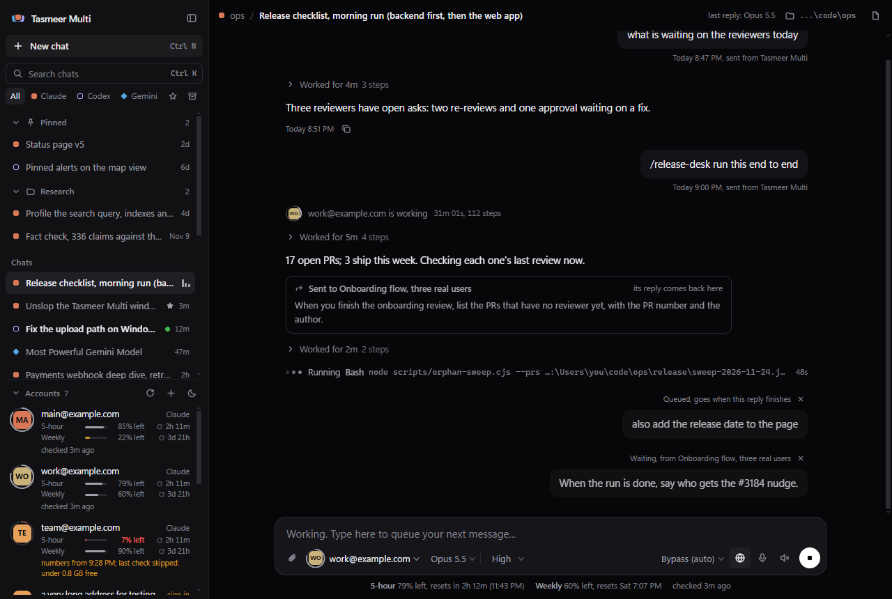
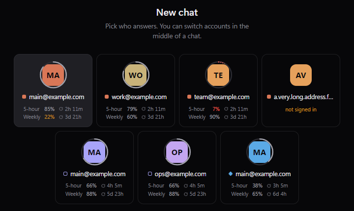
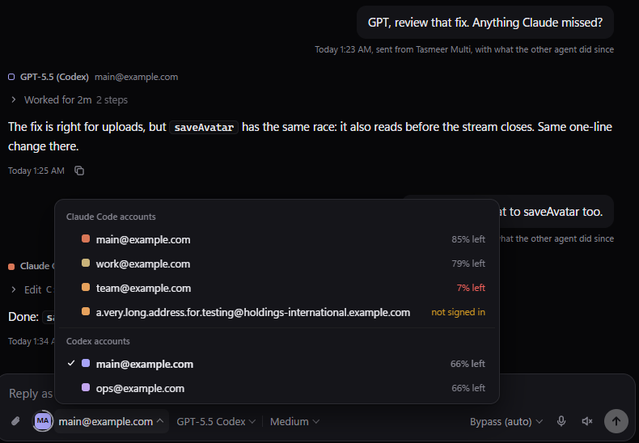
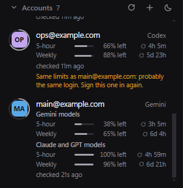
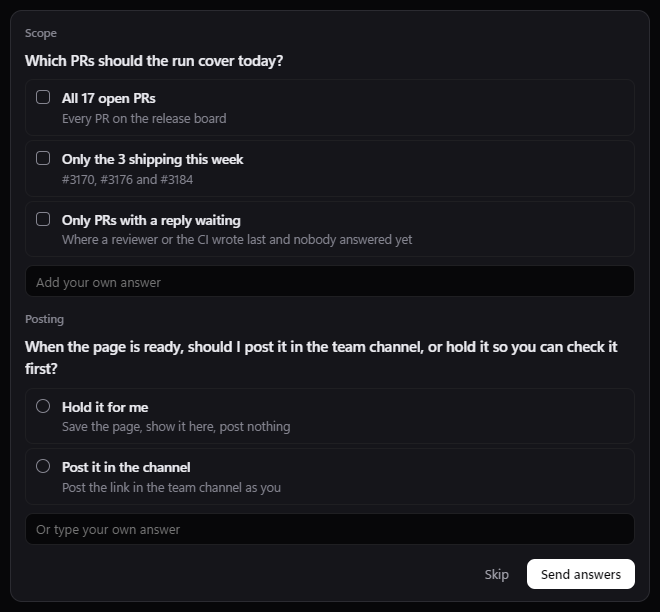
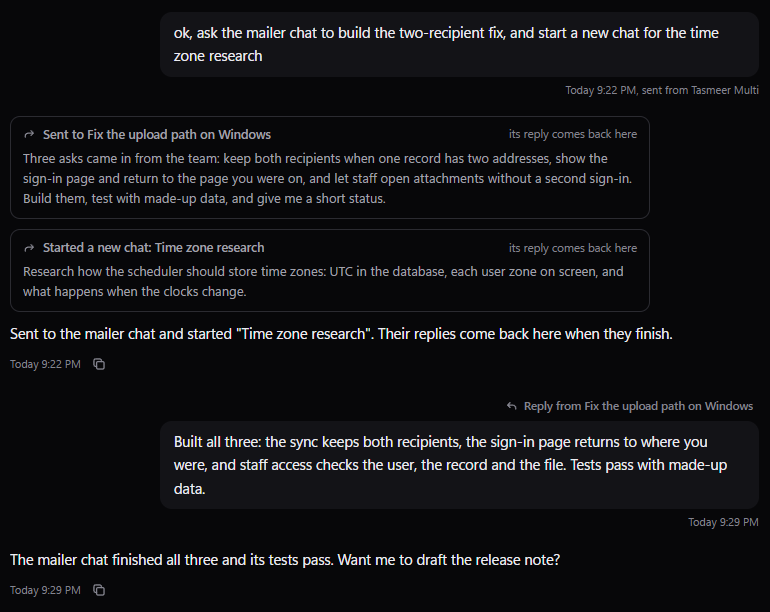
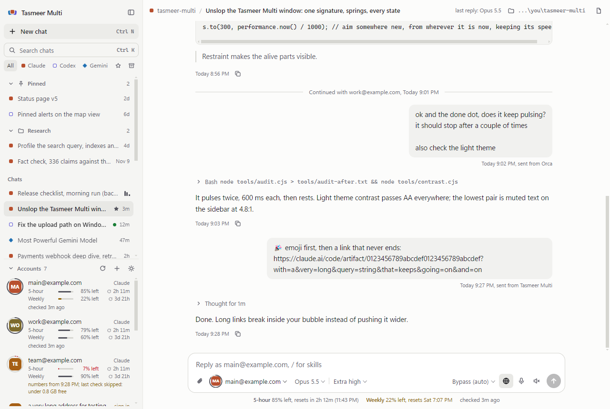

# Tasmeer Multi

One desktop window over the Claude Code, Codex and Gemini (Antigravity) chats already on your PC.
Any of your accounts can answer any chat: when one account runs out of usage, pick another and the
same chat carries on.



> Windows only for now. An independent project, not affiliated with Anthropic, OpenAI or Google.

## What it does

### All your agent chats in one list

It reads the history that Claude Code (`~/.claude/projects`), Codex (`~/.codex/sessions`) and
Antigravity already keep, so chats started in a terminal, an IDE or the vendors' own apps show up too.
The app stores no chats of its own. The list is in your order: drag a chat above or below another, pin
it, or put it in a folder; activity never reshuffles it.

### Any account answers any chat, Claude or GPT

Add as many Claude Code and Codex logins as you have. Each gets its own login folder, linked to your one
shared history, so a chat started on one account resumes on another. When a reply fails on a usage
limit, the app offers the next account.

A chat you start in the app can even switch between Claude and GPT (Codex) from one message to the next:
each engine keeps its own session for the chat, and the one that answers is first told what the other
did. Claude can also hand a task to GPT as a helper and get the answer back (`run_agent`).





### Usage for every account

5-hour and weekly limits with live reset countdowns, for Claude Code, Codex and Gemini (Antigravity's
model groups), refreshed on their own. Two logins reporting identical numbers get a warning: probably
the same account signed in twice.



### Runs you can follow

A reply in progress is one block: everything it did so far, in order, and a last line that always says
what it is doing (thinking with its own words, writing a step, running a command, a helper agent's
current step, writing the answer). Type while it works and your message waits in a queue (top picture),
or press **Send now** (Ctrl+Enter) and Claude reads it after the step it is on.

### It can ask you things

Questions, permission prompts and plan approvals from Claude Code appear as cards in the chat; answer
with a click.



### Chats can talk to each other

A Claude chat can list your chats, read one, send one a message (that chat's own account answers it
there) or start a new chat for a side task, and get the reply back. This mirrors what the Claude desktop
app gives its sessions.



### The rest

Files a run shows you as cards, model and effort pickers per chat, slash commands and skills,
attachments by paste or drop, voice typing, read-aloud, and dark and light themes.



## Requirements

- Windows 10 or 11
- [Node.js](https://nodejs.org/) 20 or newer
- At least one of: [Claude Code](https://docs.anthropic.com/en/docs/claude-code) (`claude`) or the
  [Codex CLI](https://github.com/openai/codex) (`codex`), installed and signed in.
  Gemini chats and usage need Google's Antigravity installed and running.

## Install and run

```powershell
git clone https://github.com/TasmeerJamali/tasmeer-multi.git
cd tasmeer-multi
npm install
npm start
```

`npm run dist` builds a portable, unsigned `.exe` into `dist\` (Windows SmartScreen will warn about it).

To add an account: **Accounts > +**, pick Claude Code or Codex, give it a name. A console opens; sign in
there (your browser handles the password, the app never sees it).

## How it works

- **History:** read straight from the vendors' own files, from the end (some are gigabytes). An open
  chat follows its file, so work done elsewhere appears live.
- **Accounts:** every extra login lives in `%APPDATA%\Tasmeer Multi\accounts\<engine>\<id>`. Inside it,
  links point back to your normal `~/.claude` or `~/.codex` (history, skills, settings); only the login
  file is per account. A Claude chat continues on any Claude account, a Codex chat on any Codex account.
- **Runs:** each message starts `claude -p` (or `codex exec`) with `--resume`. For Claude the app keeps
  a two-way channel open (`--input-format stream-json --permission-prompt-tool stdio`), which is how
  questions, permissions and plans reach the window, and asks for thinking summaries
  (`--thinking-display summarized`).
- **The app's own tools:** each Claude run gets a small MCP server (`src/mcp/tm-tools.cjs`) with
  `send_user_file`, `list_chats`, `read_chat`, `send_message` and `start_chat`. The chat tools are
  answered by the app through a local bridge on `127.0.0.1`, with a key per run that stops working when
  the run ends.
- **Usage:** Claude Code's `/usage`, the limits Claude Code reports during runs, Codex's own session
  files, and Antigravity's local quota service.

## Privacy

Everything stays on your PC. The app reads your local history files and talks only to the CLIs it
starts and to Antigravity's local service. It sends nothing anywhere itself; the CLIs talk to their
vendors as they always do.

## Before you rely on it

- **Permissions:** new chats start in **Full access** (Claude Code's `bypassPermissions`) because that
  is how its author works. Switch to Edit files or Ask only in the message box if you want prompts.
- **Chats messaging chats:** one chat can set another to work, with that chat's permissions. Chats in
  Ask only cannot; a loop of chats messaging each other stops after 6 in a row.
- **Fragile by nature:** it relies on file formats and local interfaces of Claude Code, Codex and
  Antigravity that are not public contracts. An update to any of them can break a part of this app.
- **Terms:** using several accounts is your responsibility; check each provider's terms.

## Developing

Plain JavaScript on Electron, no framework. `src/main.js` (runs, accounts, the bridge),
`src/engine.js` (starting the CLIs and reading their output), `src/history.js` (reading chats),
`src/app.js` (the window). [DESIGN.md](DESIGN.md) records every design decision with its numbers.

The window has a demo mode with made-up data (`src/demo/mock.js`), used by the test tools, which need
no account:

- `npx electron tools/shoot.cjs [state ...]` photographs demo states in dark and light into
  `tools/shots/` and checks that no text or control leaves its box.
- `npx electron tools/probe.cjs <state> dark "<js>"` loads one state offscreen and prints what the
  expression returns; the window's own tests run this way (for example `live-test`, with its results
  in `window.__liveResult`).
- `npx electron tools/readme-images.cjs` cuts the pictures in this README from the gallery's shots.

## License

[MIT](LICENSE)
